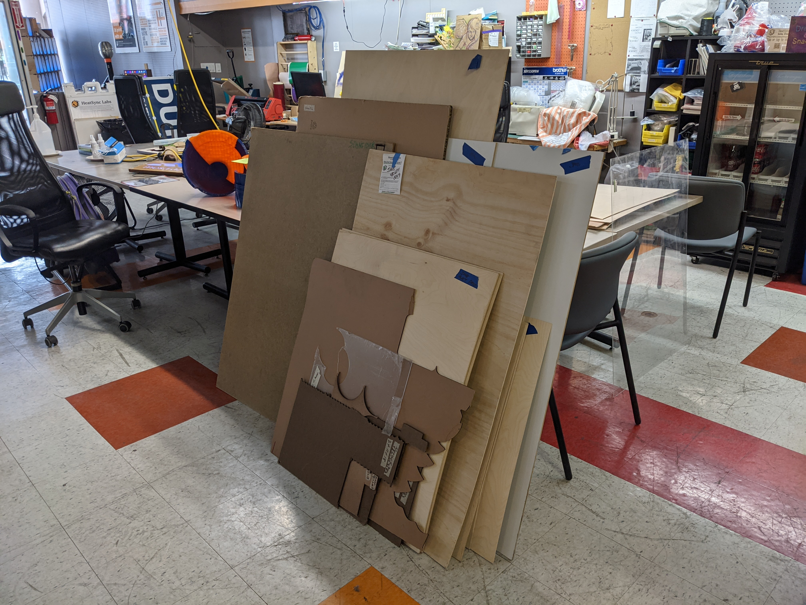

As discussed in the \[This is not a\] Proposal thread, I have cleaned out, organized and red-tagged all of the materials stored by the laser.

- Just to make sure we level set, it's my understanding that "Parking Passes" are for short term storage of 7 days or less and help us control the clutter \[1\] \[2\] \[3\]
- My intention is to complete this project after May 15th, so you have until then to claim and/or parking pass your material.
  - Some point after this day I will consolidate everything and announce to this list and slack that the material is free for the taking.
  - Some point after that I will cleanup the scrap and populate it with the things that make sense from the red-tag.

So, I have cleared out and organized all of the material from that area. Here is the before picture:

- 
  *laser_before.jpeg*

And after.

- 
  *laser_after.jpg*

## Interesting note

- There were items that had already been red-tagged. Those are now in the "scrap" area, which will be my next project I guess. Most of them had parking pass dates of 2017 and had been red-tagged in 2019, to give you a sense of their age.

## Organization

There is now a pile listed as red-tagged that has material with no identifying information on. So, if you have something you know you had, but can't find, it might be in that pile. It's over by the chair corral/can crusher. (There is now a red-tag sign pointing at it on the sign)

- 
  *noname.jpg*

Disorganized random named items are located next to and on-top of the tables. This includes things like the sheets of glass that couldn't be cut anyway (but maybe etched) If you had one or two things they're likely in here.

*misc.jpg*

Pile of stuff where people had a good number of items.

- 
  *PXL_20210426_230338708.jpg*

This pile contains material from the following identifications:

- Luis
- Shaundra
- Schneider
- Nancy Gibson
- JME
- Chase D
- Greg Oswalt
- James
- Travis
- (maybe others?)

Big stack of plywood

*plywood.jpg*

Names on this are Timmons and Crummey

There are also separate piles set aside and individually tagged from:

- Lavelle
- Milton
- Linwood

Nathan has also parking passed his material and put it in the storage bin.

Apologies on the temporary clutter around the lab. I struggled with making things accessible and not having them in the way.
