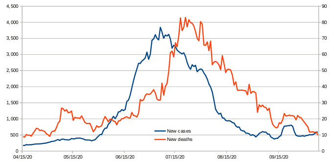

*2020-10-09-az-cases-and-deaths.png*

For comparison, the top 10 causes of death in AZ (not counting COVID-19, approximated from national numbers):

- Heart Disease: 39 deaths per day
- Cancer: 36 deaths per day
- Accidents: 10 deaths per day
- Chronic Lower Respiratory Disease: 10 deaths per day
- Stroke: 9 deaths per day
- Alzheimer’s: 7
- Diabetes: 5
- Influenza & Pneumonia: 3
- Nephritis, etc: 3
- Suicide: 3

Source: [The COVID Tracking Project](https://covidtracking.com/data/state/arizona)

---
*Categories: [InterestingData](Category-InterestingData)*
