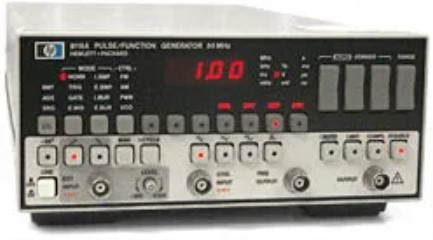

- **Station Champions:** David Flores, and Nate Caine
- **Communication:** Slack \#electronics channel
- **Certification:** None, ask if you need help with something
- **Events:** Arduino Night 1st Wednesday each month 7pm

**Welcome to HeatSync Labs Electronics Station.** There are a lot of great tools and things to learn. You must have a waiver filled out to use tools at HeatSync Labs. other than that you don't require any special classes or training if you already know how to use them you can do so. If you need to learn how to use a tool then come out during Arduino Night

**Events:** Arduino Night is the 1st Wednesday of every month between 7pm - 10pm. No experience necessary.

**Supplies:** Yes you can use the general component supplies, please contribute back by helping restock things that are running low.'''

**Station Champions:** David Flores, Nate Caine

## Test Equipment

### HP 8116A 50MHz Programmable Pulse Function Generator

*HP8116.jpg*

[8116A_50MHz_Programmable_Pulse_Function_Generator_Manual.pdf‎](files/8116A_50MHz_Programmable_Pulse_Function_Generator_Manual.pdf‎)

*8116A_50MHz_Programmable_Pulse_Function_Generator_Manual.pdf‎*

### Rigol Digital Oscilloscope

model number image manual

### Tektronix Analog Oscilloscope

model number image manual

### Tektronix Modular 500-Series

#### DMM-501

#### PS-201

#### PG-101

## Soldering Station

[http://mightyohm.com/soldercomic good intro to soldering](http://mightyohm.com/soldercomic_good_intro_to_soldering) for those who are new.

### Metcal

### Weller

### Hakko

### Hot Air Station

## Microcontrollers

The various microcontrollers are here for you to use to test out ideas. Please put them back at the end of the day. If you think we need one of the latest and greatest controllers for others to learn grab one and add it to the collection.

### Arduino

- Arduino Uno R3
- Arduino Duemilanove

### Raspberry Pi

## Parts Inventory

### Integrated Circuits

### Discrete Components
