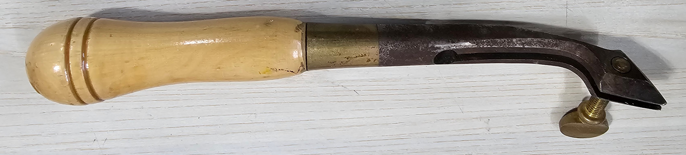

# File:Edge Creaser.jpg

**File:** [Edge_Creaser.jpg](files/Edge_Creaser.jpg)

*image/jpeg, 288,040 bytes, 3377×764*

## Description

Edge creaser. Used to impart a decorative line along edge of leather. A more refined look. The left tine goes on surface of leather, right rides along the edge to keep a straight line. Could use some love if anyone enjoys restoring hand tools.
