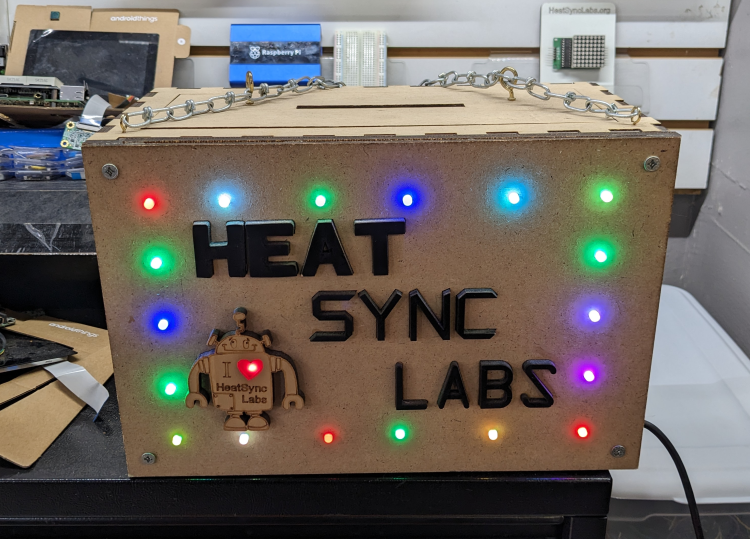

# File:Electronics Donation Box.png

**File:** [Electronics_Donation_Box.png](files/Electronics_Donation_Box.png)

*image/png, 653,119 bytes, 750×539*

## Description

A donation box that David Flores built. The heart has an LED that flashes red and blue, but the red acrylic blocks the blue from showing which is clever.
