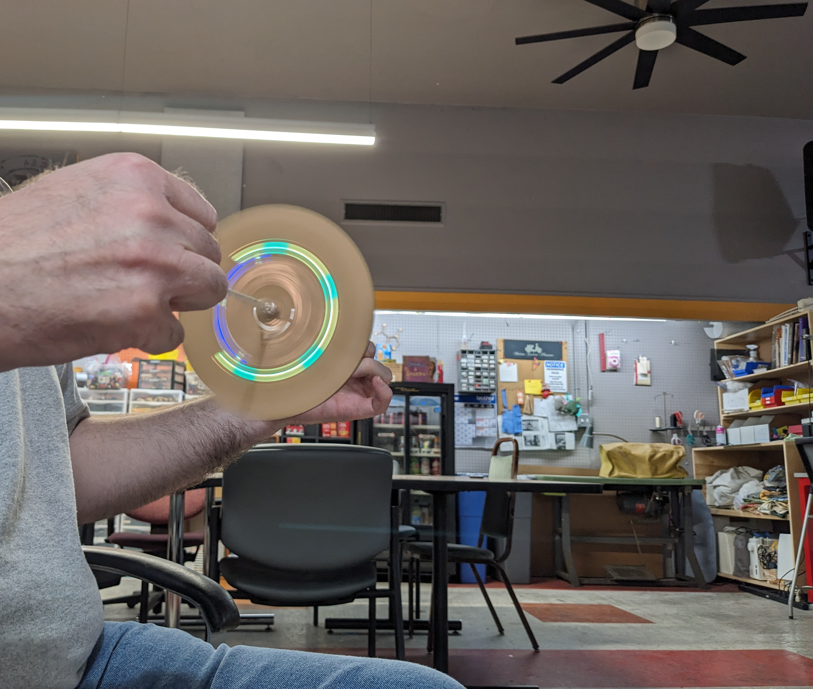

# File:Fun and Games Day Prototype Spinner.jpg

**File:** [Fun_and_Games_Day_Prototype_Spinner.jpg](files/Fun_and_Games_Day_Prototype_Spinner.jpg)

*image/jpeg, 2,423,864 bytes, 3416×2898*

## Description

A laser cut cardboard spinner and some nylon rope that shows of the fast blinking that LED's do to show different colors.
