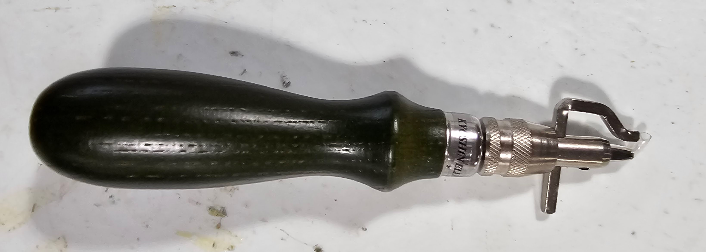

# File:Groover.jpg

**File:** [Groover.jpg](files/Groover.jpg)

*image/jpeg, 220,682 bytes, 3279×1175*

## Description

This is a groover. Its purpose is to carve a small groove where the stitch line will go before stitching holes are chiseled. This allows a more low-profile stitch line in order to minimize abrasion in high-wear areas. The other option is placing a crease with wing dividers or a scratch awl.
