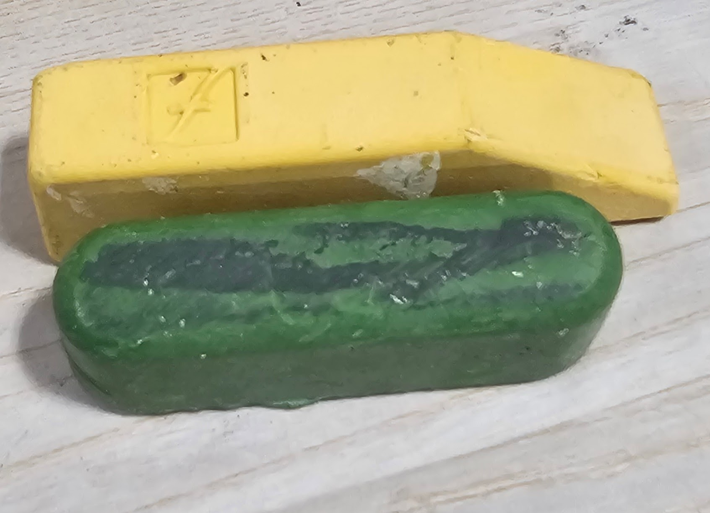

# File:Honing compound.jpg

**File:** [Honing_compound.jpg](files/Honing_compound.jpg)

*image/jpeg, 152,492 bytes, 1693×1224*

## Description

Stropping compound. The yellow is the more coarse of the two, and so would be used first, with the green being a finer grit and used second.

These can sharpen a blade using a strop (can be easily made or purchased). They can also sharpen edge bevelers by loading a bit onto a piece of thread and dragging it through the groove.
