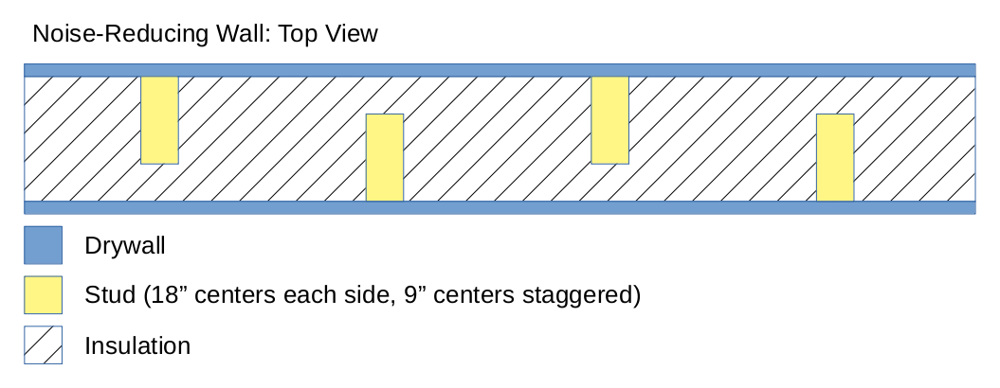

# File:noise reducing wall structure.png

**File:** [noise_reducing_wall_structure.png](files/noise_reducing_wall_structure.png)

*image/png, 26,023 bytes, 1055×410*

## Description

This is a wall structure that I heard about from a podcaster who used it to make a sound isolated recording booth in his house. The outer wall is not connected to the inner wall, which reduces sound transmission through the studs.
