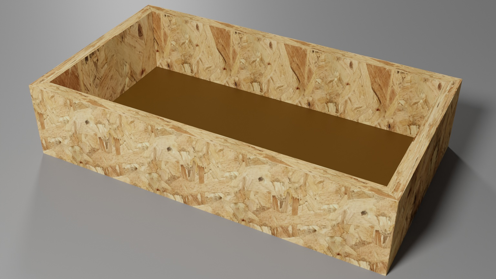

# File:osb frame with bottom.jpg

**File:** [osb_frame_with_bottom.jpg](files/osb_frame_with_bottom.jpg)

*image/jpeg, 266,499 bytes, 1536×864*

## Description

This is an open top box that can be created during the basic table saw class. This box is also suitable as part of the arcade control class.
