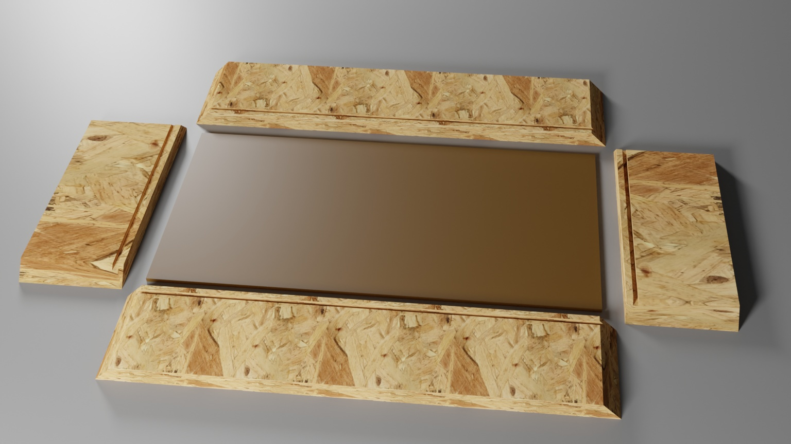

# File:osb glue-up with bottom.jpg

**File:** [osb_glue-up_with_bottom.jpg](files/osb_glue-up_with_bottom.jpg)

*image/jpeg, 243,539 bytes, 1536×864*

## Description

Parts that will be cut to prepare for gluing-up an open-top box. This box can be made during the basic table saw class and also acts as one step in the arcade control class.
