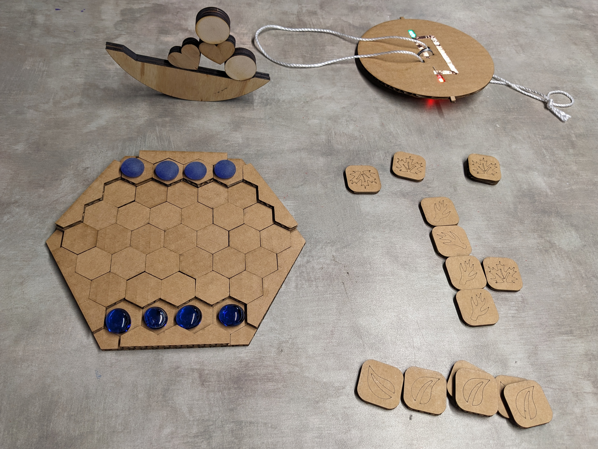

## When

Saturday 03/09/2024 any time from 11am - 5pm

This is during [I Love Mesa Day](https://downtownmesa.com/do/i-love-mesa-day-2024) when there will be a lot going on downtown.

## Description

Come have fun making and playing games. We will be making and giving away free games, puzzles, and toys with the laser cutter, 3d printer, soldering irons and other tools in the lab. This free event is for everyone. Anyone under 18 must have an adult with them.

## Prototypes

I've worked on some prototypes for [Iso-Path](https://www.youtube.com/watch?v=Wz6q03b8R6U), and [Leaves](https://www.printables.com/model/72515-abstract-strategy-game-leaves) which are both abstract strategy games. A simple balance game, and a fun spinner with LED's. A big multi-person marble maze is being constructed. A couple electronic games in the works as well.

 

## History

We did a [Fun and Games Design Challenge](https://guestlist.co/events/736986) on 02/19/2023. The intention was to create files for projects we could then turn around and use during Fun and Games Day. There were not many people signed up.

---
*Categories: [Events](Category-Events)*
