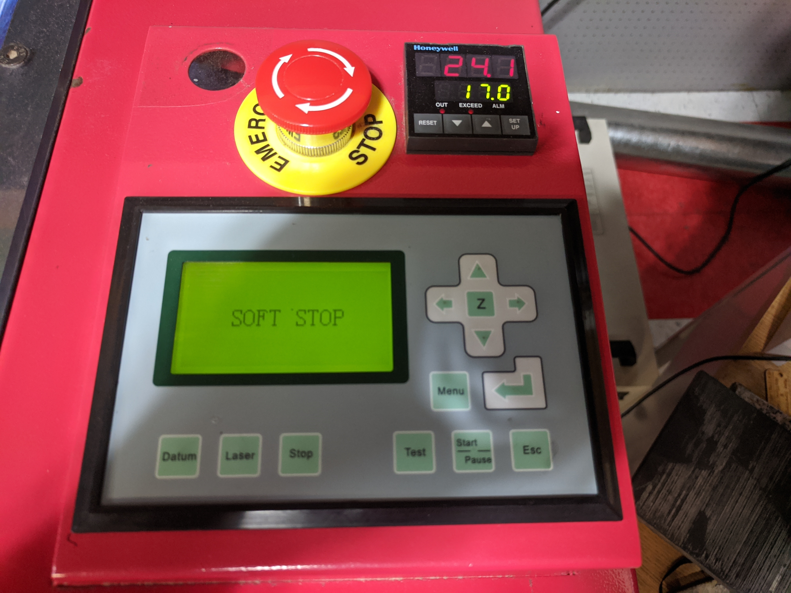

# Overview

This is the main quick guide for the large laser cutter (aka PewPew9000 for reasons I'm sure the old-timers can explain). It will likely get rearranged, but in phases.

## Size

The largest material that will fit in the laser is 48" x 32" but the cutting area is smaller.

## What you can cut

These lists are not exhaustive. If your material is not on either list, ask first!

- See the [Laser Material Guidelines](Laser-Material-Guidelines) for a list of materials and common speed and power settings.

## Operation

### Turn on the laser

1.  Turn on the machine
    1.  Turn on the switch
    2.  be sure to disengage the E-STOP
    3.  Verify the following are up and running
        1.  Laser Cutter
        2.  Chiller
        3.  Exhaust fan
        4.  Air compressor

### Start the software

1.  Start the [LaserCut 5.3](LaserCut-5.3)
    1.  Communication Problem?
        1.  Click download to regain communication
        2.  Save work
        3.  Exit LaserCut
        4.  Restart LaserCut
    2.  “SoftDog” dongle errors
        1.  These are usually random
        2.  retry

### Load your files

1.  Create your design
    1.  For more detailed discussion, checkout [Inkscape](Inkscape)
2.  Shapes, Text, Graphics
    1.  Use [LaserCut 5.3](LaserCut-5.3) for simple work, or
    2.  Import from Adobe Illustractor, [Inkscape](Inkscape), Corel, AutoCad, etc
3.  Assign objects to layers then values for:
    1.  Speed
    2.  Power
    3.  Frequency
    4.  Output
4.  Set drawing origin (Choose intelligently based on your design)
5.  Click Calculate
6.  Simulate (this can help you spot problems)

### Prepare the material

1.  Lower the table so that material doesn't hit the laser head
2.  Position material in center of bed (use squaring blocks if necessary)

- [Focus the laser](Laser-Focus)

#### **If you run the head through the table hit the E-STOP and see [Laser Cutter Emergency Guidelines](Laser-Cutter-Emergency-Guidelines)**

### Send your design to the laser

1.  Download the design to the laser cutter
    1.  Click “Download” then “Download Current”
    2.  Close the download window

### Make sure your design fits on your material

1.  Check design boundary
    1.  Click "Run Box" to outline the extent of your design area without the laser powering on
        1.  Don't use Clip Box or it will power on the laser

If the "Run Box" doesn't run and the machine gives you a "Soft Stop" it means it detected that the box would be outside of the laser area.

*9000-soft-stop.jpg*

There are a number of things that can cause this:

- You have set the origin and the current laser position in such a way that it will run out of table.
- There is something in your design that would send the laser way off of where you expect.
  - The best way to find these is to make sure you run "Simulate" out of LaserCut to see what it's trying to do.
- Gremlins.

Once you've fixed your problem, or think you have, you can hit ESC on the machine control pad (lower right) and re-upload and try again.

### Safety

1.  Remember your [Laser Cutter Safety Training](Laser-Cutter-Safety-Training)
    1.  Locate water spray bottle
    2.  Locate fire extinguisher
    3.  Most flare-ups will self-extinguish when the laser stops
    4.  Stay at the laser while it is running. If you must leave, someone else trained must take your place.
    5.  If you need to suspend your job quickly, raise the hood. Cutting will resume when you lower the hood.
    6.  Due to software bugs, do not use the Pause or Stop buttons on either the machine or software

### Fire in the hole!

1.  Start the Laser
    1.  Click 'Start'
    2.  If you must suspend you can open the hood or click 'Start' again.
    3.  Avoid using "Stop" or "Pause" if possible.

### Finishing

1.  Finished?
    1.  Wait for cooldown and exhaust to clear
        1.  Temperature display should be below 25°C
    2.  Turn off the key lock switch
2.  Verify the following are off:
    1.  1.  Laser Cutter
        2.  Chiller
        3.  Exhaust
        4.  Air Compressor

#### Clean up the machine

1.  Rails
    1.  Clean each rails with a rag and alcohol. Gloves are recommended.
2.  Scraps
3.  Drawer
4.  Hood

#### Document!

# Logs

- [80 Watt Laser Form](https://forms.gle/ieRTGmS3ipfLVE7Z9)
- [80 Watt Laser Responses](https://docs.google.com/spreadsheets/d/1BpAYtyFIKQ4UoXv31mKC43YFxfBk34d_q-muw1SP2aU/edit?usp=sharing)

## Old logs

Please document your work!

- Work log to [form](https://docs.google.com/forms/d/1ld4T9pDXP6uqZbYmlebe9SxATHcP436kMobnhSQEKPI/viewform).
- Work log [results](https://docs.google.com/spreadsheet/ccc?key=0AoBMPvlNCqvldHl5SERwRHVjN09wRHEtODZzd2RXNWc&usp=sharing)
- Log any issues. Redtag device if necessary.

# External links

- [Refresher video](https://www.youtube.com/watch?v=SC4RUOU0vTg)

---
*Categories: [Laser](Category-Laser)*
