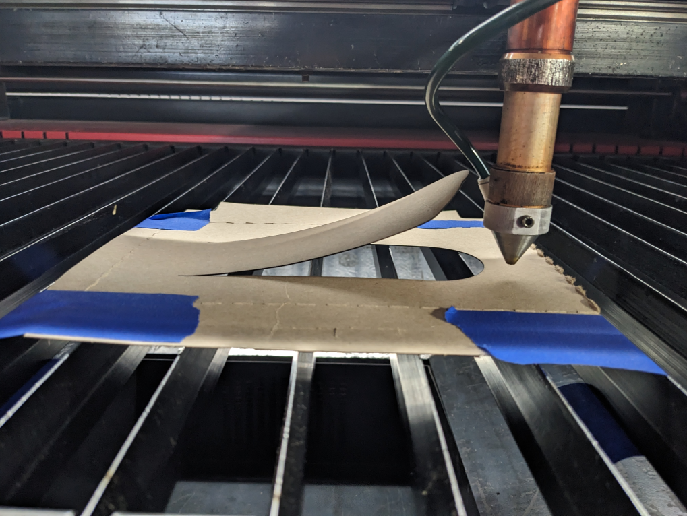
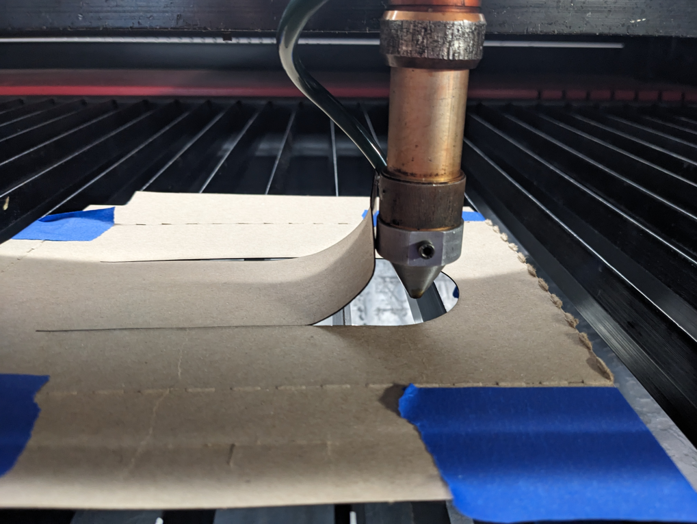
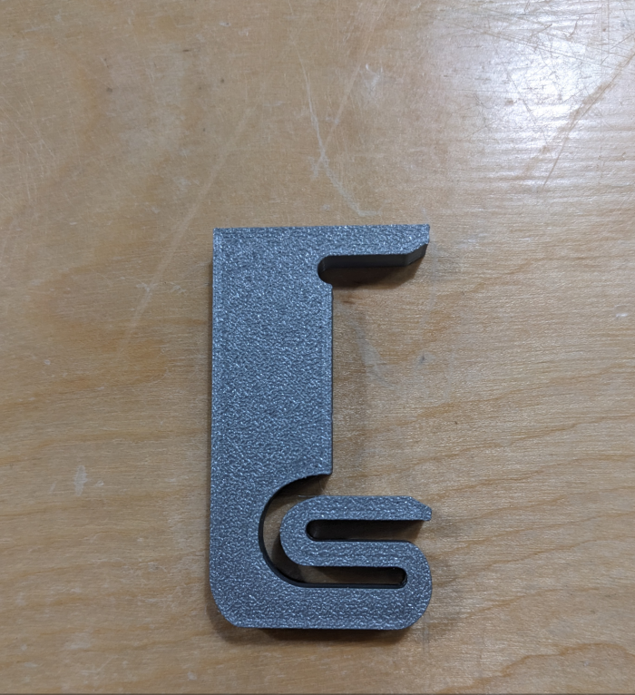
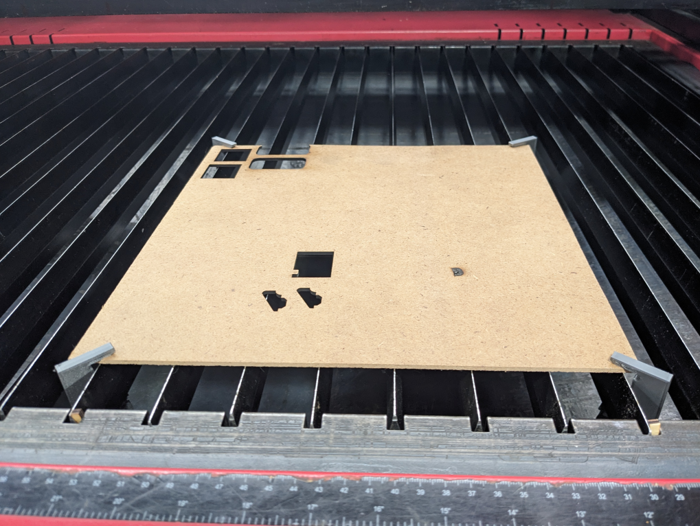
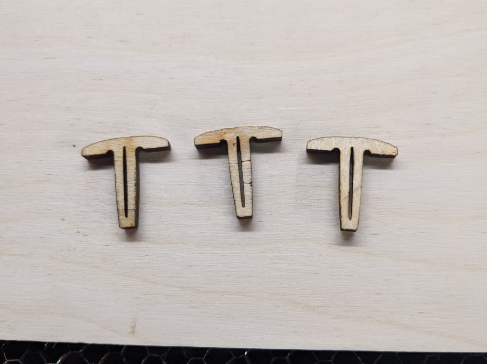
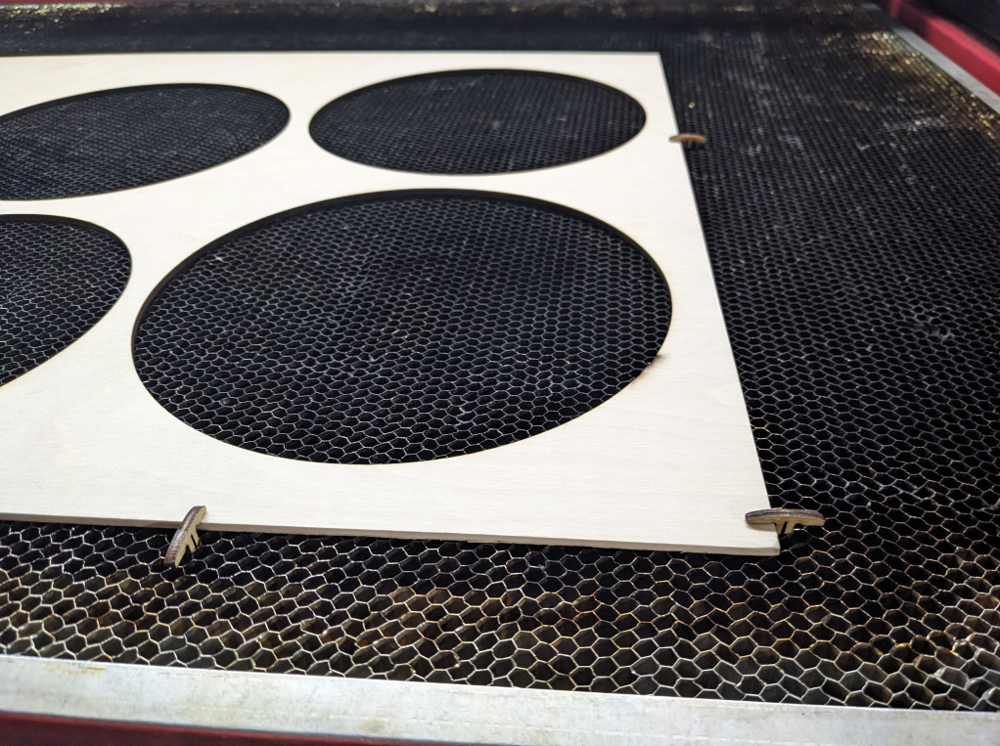
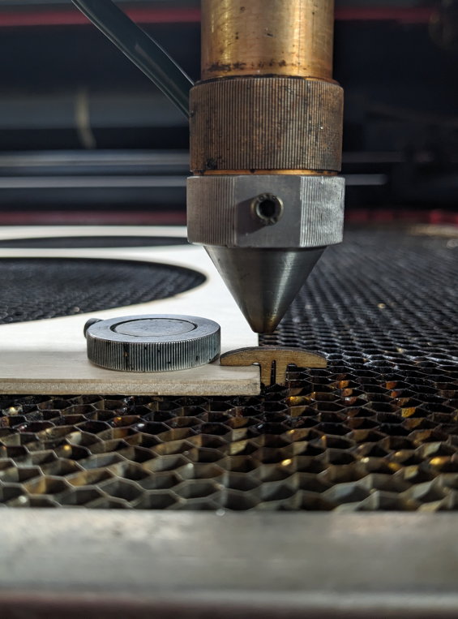
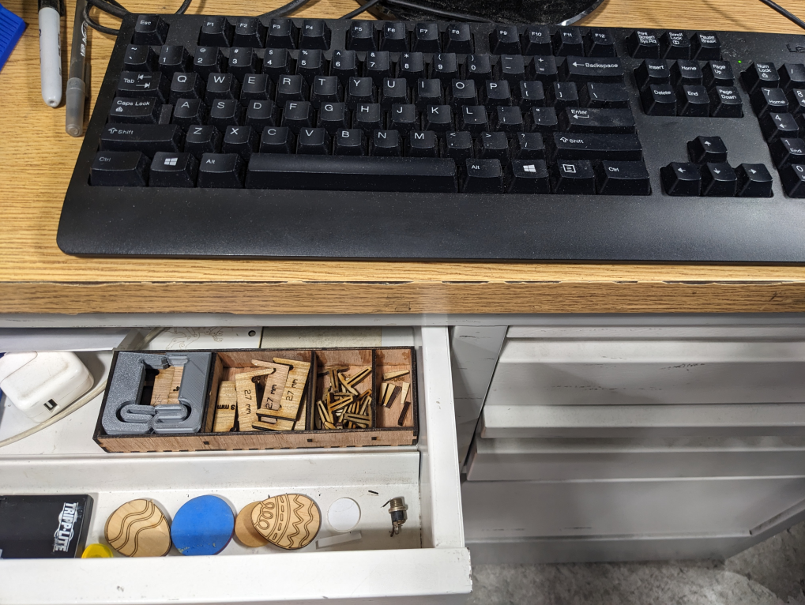
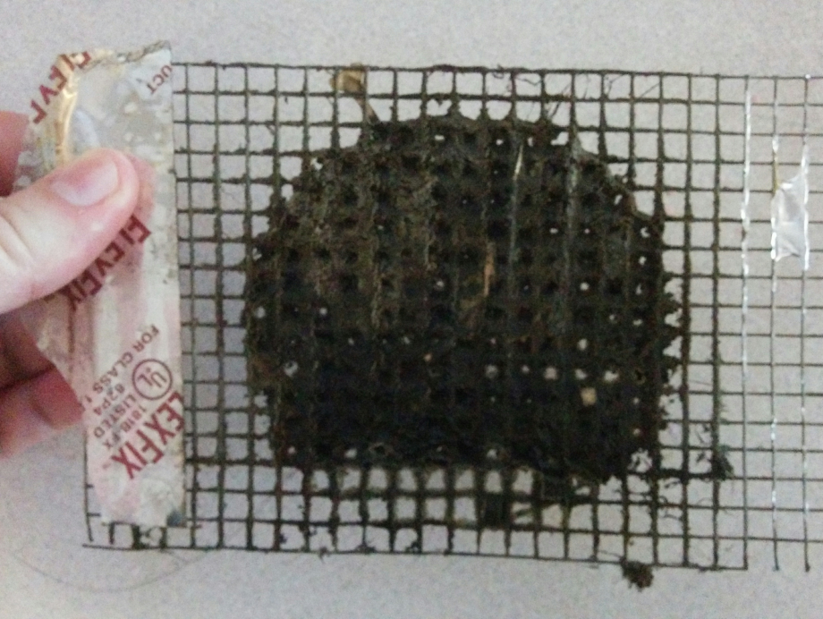
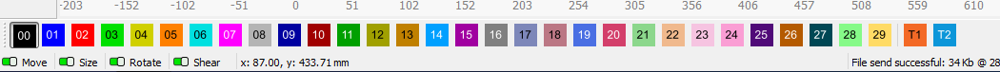

In this FAQ for the [Laser Cutters](Laser-Cutters) we will be listing all the questions people have and attempt to answer them or link to answers. This will serve as a single searchable page for questions.

# Misc

## Q: Who should come to the Laser Meetup?

- Anyone who is interested or curious even if you don't have a design in mind.
- Anyone wanting to get help on a design or time cutting a project (you don't need to be certified ahead of class).
- Kids can come as well, but anyone under 18 must have an adult parent or guardian with them.

## Q: Why did I hear something beep 5 times?

- That could be the medical cart locking. Not a problem.

## Q: Is the 80 W laser log accessible on both computers?

- Both of them can be accessed from anywhere on the internet [ 80W Logs](Large-80W-Laser#logs), and [ 60W Logs](Mini-60W-Laser#logs).

## Q: How do I design a project for the laser cutter? OR What software do I use to design a project for the laser cutter?

- You can use either CAD or vector graphics software.
  - For CAD tools Fusion 360 and Solid Works are the most commonly used, but any CAD software should export dxf files needed.
  - For vector graphics software Adobe Illustrator and Inkscape are the most common, although corel Draw and other are often used.
    - For vector design a common starting point is tracing an raster image to create a path.
    - [Inkscape Tutorial: Complete Starter Guide for New Users](https://www.youtube.com/watch?v=fzk-suGcqrc)
  - There are too many [3D modeling](https://en.wikipedia.org/wiki/List_of_3D_modeling_software), [Vector](https://en.wikipedia.org/wiki/Comparison_of_vector_graphics_editors), and [2d graphics](https://en.wikipedia.org/wiki/List_of_2D_graphics_software) tools to cover so instead see those Wikipedia pages which list them.
- There are also online generators for things like boxes, puzzles, mazes and more.
  - [The Ultimate Guide to Laser cut Box-Generators](https://www.instructables.com/The-Ultimate-Guide-to-Laser-cut-Box-Generators/) is a great resource for box generators.
  - [Paper box template generator](https://www.templatemaker.nl/en/).
  - [This page has a range of other generators](https://makerdesignlab.com/tutorials-tips/online-file-generators-for-laser-cutting/).
- You can also search online for project ideas at sites like <https://www.instructables.com/>, <https://www.thingiverse.com/>, or similar sites.
- This YouTube video has a summary on [60 laser cut projects](https://www.youtube.com/watch?v=6z4nWIibNkA) with links to tutorials that may be good inspiration.
- You can buy design files on Etsy or other places. Just be aware some designers do not know how to make design that work well for laser cutting or 3d printing. Look at reviews closely.

## Q: What are the model numbers of our laser cutter?

- The 80 Watt Laser is XYZ Technologies Exlas 1280, so is 1200mm x 800mm laserable.
- The 60 Watt Laser is a Tek Genius "[60W 110V CO2 Laser Engraving Machine](https://laser-engraving-machines.net/tek-genius/60w-500x700mm-co2-usb-laser-engraving-cutter-stand-cutting-machine-engraver-17170)", or similar. No real model number that we know of.

## Q: Can I schedule the laser? / What do I do if someone is already using the laser?

- We don't schedule the laser (other than for classes).
- If you arrive while someone is using the laser let them know you'd like to be next and ask them how long they will be.

# Materials and Cut Settings

## Q: What materials can I cut or engrave with the laser?

- The [ Laser Material Guidelines](Laser-Material-Guidelines) wiki page aims to cover that.
- There is also a growing collection of samples in the [ Laser Example Book](Laser-Example-Book). Please help us make this book more useful.

## Q: Should I change the speed or the power?

- It depends.
  - Changing one at a time is preferable.
  - Changing the speed has more of a linear relationship to the cutting depth. The upper power percentages have decreasing increase in cutting depth.
  - Slowing the speed can increase the quality of the cut for acrylic.

## Q: Can I engrave metal with the laser?

NO! You cannot engrave, cut or etch metal with the HeatSync Labs c02 laser. Some online reports claim to have methods of cutting stainless steel with a c02 laser using a special coating to assist absorption. We don't allow attempting to cut metal (engrave, etch, or whatever term you prefer) with the lab c02 laser cutters. We recommend people experiment with their own laser cutters if they chose to explore those options. That way they are responsible for replacement of their own lenses and mirrors. We have enough wear and tear on the machines with the current use cases. More would not be desirable.

You can laser engrave coatings off of metals. Coatings like acrylic paint, anodized layers. Things that will absorb the infrared laser. Just be cautious about power settings so the laser isn't reflecting back up damaging the lens.

## Q: What size material can I cut with the laser?

- See here; [ 80W](Large-80W-Laser#size), [ 60W](Mini-60W-Laser#size).

## Q: How thick of material can I cut?

- This largely depends on the material. See the laser logs for the [ 80W](Large-80W-Laser#logs), and [ 60W](Mini-60W-Laser#size) for examples of what people cut. It lists the dimensions.

## Q: I'm at 100% for power and not cutting through; Should I use 2 passes to cut through my material or change my settings to go slower?

- Ideally, you don't want to use 100% because it shortens the life of the tube. We try to max out at 80%.
- Typically you'll want to go slower. If you do multiple passes there may be debris left in the cut, and it may misaligned if heat causes warping to your material or anything else causes movement of the material.

## Q: Is the MDF from Home Depot/Lowe's good enough or is there a better place to get MDF?

- Big box stores will have the price advantage because of volume. Sourcing and quality are super subjective, so its up to you. An art store like Jerry's may have finer stuff but you will pay a premium.

## Q: How finely can I engrave with the lasers?

- If you are asking about how fine the line or kerf of the laser is; In my experience the 80W laser is 0.125mm or larger if out of focus due to height or warping. The 60W laser provides a finer point much closer to .1mm. (summarized Robert Douglas Slack response).

## Q: Where do you buy materials?

- Most of your major online retailers.
- [Port Plastics](https://portplastics.com/) is local in Chandler. There is a minimum order amount.
- [Houston Acrylic](https://houstonacrylic.com/) has a good selection of specialty acrylics.
- [Laser Bits](https://www.jpplus.com/laserbits) now owned by Johnson's plastic has a variety of materials.
- [BuyPlastic.com](https://buyplastic.com/) reported by Lily as the lowest prices on acrylic she could find.
- [Peach Street Acrylic](https://peachstreetacrylic.com/) Margo likes this and Smokey Hill Design.
- [Smokey Hill Designs](https://smokeyhilldesigns.com/).
- [CMB Acrylic](https://www.custommadebetter.com/). Thanks Jenn K. for the suggestion.
- [Toolfoam.com](http://toolfoam.com/) This is for drawer tool insert. Thanks Jot for the suggestion.
  - Foam cutting is very messy. Talk to Nate about helping him clean the vents if you cut a lot.

## Q: Where can I buy materials locally?

- Lumber shops will probably have higher quality than your big box hardware stores.
- [Timber Hardwoods](https://timberww.com/) has good Baltic Birch Plywood that is usually better quality.
- [Woodworkers Source](https://www.woodworkerssource.com/) has a location in Chandler.
- [Port Plastics](https://portplastics.com/) in Chandler for acrylic.

## Q: Any issues cutting 1/4" walnut on the laser?

- Should work fine. May require slower cutting and higher temperatures on the 80W laser. May present more of a challenge on the 60W.

## Q: Why are my parts getting burn marks on them?

- If your parts are small and falling after cut it may result in them getting burnt as other parts are cut above where they ended up.

## Q: What woods are good for engraving photos?

- Basswood or maple are recommended often for this because they have a more consistent grain structure.

# Material Workholding

## Q: How do I keep my warped material flat? / How do I hold my material in place and keep it from moving?

- **Caution should be used with warped material.**
  - **The laser can be damaged if the cone hits material as shown below.**

 

- There are several options. Large sheets should stay in place OK on their own. For other things you may want tape, clamps and wedges, or T-pins with the honeycomb.
- The newer PETG clamps are flexible and can hold material between 3mm and 6mm (1/8" - 1/4").
  - Use a wedge to prevent the rail from moving left to right.
  - Be sure the thinner profile is on top to allow for clearance of the laser cone.
- The T-Pins work with the honeycomb surface and work pretty well.
  - Again watch for the clearance with the cones.
- Tape works but was always trying to lift the rails.
  - With the wedges that's not a problem.
  - Alternately having the tape pull more to the side avoids it lifting the rail.

     

# Laser Operation

## Q: Why doesn't anything happen when pressing xy, or z to move the laser.

- Press the Download button to regain communications. You can close the window.

## Q: How do I make the laser go to a specific place on the laser bed?

- LightBurn has a setting called absolute coordinates, the other option is current position.
- LaserCut 5.3 has a similar setting labeled immediate. Uncheck that for absolute coordinates.

## Q: Why does the run box or frame option not fit on my material.

- Check to see if you have any extra parts outside of your design. When using the select option you should be able to use the Control+A to select everything which should help you see any extra very tiny parts.
- Double check your expected dimensions against your material. There may have been a scaling issue when importing your design.

## Q: Why doesn't the laser start my job or run the box and instead beeps 10 times? Why does the 80W laser show a soft stop error?

- Check the control panel and see if it says soft stop. If that happened it means the job was going to cut out of bounds so it terminated the job.
- Make sure your job is downloaded.
- Look at your options for origin point, and if immediate was checked or not.
- Run the simulate and check for any design features outside of where you expect them.
- If those don't work try with a small test shape. If that doesn't work restart things because something is wack.

## Q: Why did the laser start cutting as soon as I shut the lid.

- This is a known problem. When you press pause on the LaserCut 5.3 software then open the lid it starts for some reason.

## Q: What order is my design going to cut in?

- The software will go from top to bottom in your layers (colors) for any that are set to output. Within those elements it will probably try to cut things that are near each other. Preview or simulate are going to show you more about what order things are happening in without actually cutting the job.

## Q: How do I create a new layer?

- To create a new layer or color use the toolbar at the bottom of the software. Just selecting the items then clicking a color will assign it a new color.
- You can assign the color of your paths in your design software by using the [ instructions here](Laser-FAQ#q-how-do-i-make-the-lines-in-my-design-import-into-lasercut-53-or-lightburn).

## Q: Is there a rotary attachment?

- Yes for the 80 W laser and it does require special training to use. Post on Slack asking to get help using it once have some experience using the 80 W laser.

## Q: Can you vary power during an engrave? OR Can you engrave at different depths / Can you do a gray scale engrave?

- Engraving gradients is done by dithering an image and LightBurn has some nice settings features for engraving images, but the laser power isn't adjusting. You can create separate engrave layers and cut them at different powers, but no true variable power cuts.

## Q: Why is there so much smoke in the laser? Why is there smoke coming out of the laser?

- The vent screen may be clogged (see below for photo example).
- Cleaning the duct work may be necessary to improve airflow. Please discuss with the station champions if you want to help with this.
- It may not be cutting very well and leading to excess smoke.
- Your material may just be a very smokey material.
- You may have covered too much of the laser bed with a large sheet of material leaving no room for air to flow down into the vent.
  - In this case as holes get cut it may vent better.
- The other laser may be open causing more air to be coming from there rather than the laser you are using.
- It may be a combination of multiple things.

*Dirty 80 Watt Laser Vent Screen*

## Q: What does this error on the 60 Watt Laser mean: "Water error Work Paused"?

- This may just be the lid being open when someone tried starting the laser, or the chiller having an error. The laser has 2 lid switches one tells the software to pause. The other is tied into the same interrupt circuit as chiller interrupt. If the chiller gives an error it will turn off power to the laser tube.

## Q: Can I start a job directly from USB?

- No.
  - Extra No. The 80W laser includes a button that crashes the bed into the laser cone. Do not use the control panel other than the escape button.
  - The 60W doesn't have auto focus / z-datum, but you could accidentally change settings via the control panel. Just use the control panel to move the position, but don't adjust any settings. Just avoid using the menus via the control panel.

## Q: Why doesn't the laser cut when I start my job?

- The power setting may be too low. You need at least 20% on the 60W laser and 14% on the 80W laser
- The switch for the laser tube may be turned off (applies only to 60W laser).
- If the lid is open it should also cut power to the laser. Make sure the switch for the lid is engaged.

# 80 Watt Laser Operation

## Q: I'm getting a "soft dog" error when trying to use LaserCut 5.3.

- This is a known error with communication to the software dongle. Usually just trying a second time communicates successfully. If it continues please log your problems and also you may need to restart the software and or the laser/computer.

# 60 Watt Laser Operation

## Q: Why is the red indicator laser not aligned with the cutting?

- This laser diode is not inline with the co2 laser and frequently will be bumped from it's original spot. Also it if your material is not flat it will show up slightly in front of or behind where the laser cutting will happen.
  - It is best to ignore the beam or manually check the alignment before you start cutting. Press the pulse on the laser to cut a dot and check alignment.

# File questions

## Q: What types of files do I need?

- LaserCut 5.3 (80 Watt Laser) takes .dxf format.
  - In Adobe Illustrator to export a dxf go to the menu File, Export, Export As and choose DXF 2000.
  - Newer versions of DXF may pose problems. In Inkscape you can save as DXFR12 or DXFR14 one or both should work.
  - In cases where you can't get the designs to import correctly into LaserCut 5.3 you may try importing into LightBurn and subsequently exporting them. This has worked well in some cases. Some missing or incorrect elements were recognized and exported correctly and with LightBurn.
- LightBurn (60 Watt Laser) takes [various file types;](https://docs.lightburnsoftware.com/BasicUsageEssentials.html#importing-artwork) Vector / mixed formats .ai, .svg, .dxf, .pdf, .plt, .hpgl. Image formats: .png, .jpg / .jpeg, .bmp, .gif, .tif / .tiff.

## Q: My file imports with lots of segments of lines and curves that aren't connected. How do I make them all connected.

- For LaserCut 5.3 you use the Tools menu then Unite Lines.
- For LightBurn you use Edit Auto-Join Selected Shapes.

## Q: Is it better to use a raster image to engrave or to use a vector?

- This answer highly depends on the artwork in question. For images with gradients engraving in LightBurn works great. For black and white designs one reason to change to vector may be time. Engraving a clock face for instance will result in a lot of travel between the numbers that isn't cutting. If they are all separate layers it'll go quicker. Alternately in LightBurn you may try the "Offset Fill" option especially for thinner fonts. Functionally there should be no difference with a black and white image engrave of high enough quality so it really is only a matter of time.

## Q: Why is the text in my file coming up wrong?

- Possibly the font that you used is not on the laser computer. You may need to convert the font to a path before importing it.

## Q: Why does my design come in with the wrong dimensions (didn't scale correctly)?

- This depends on how your design software assigns units of measurement which is outside the scope of this FAQ. However you can resolve most if not all of these problems by checking the total size of your design then scaling it once you bring it into the laser software.
  - For LaserCut 5.3 you can go to Edit Size to adjust your design size.
  - For LightBurn the top bar has the size and you can adjust it there.

## Q: I have lines that extend beyond the boundaries of the document. If I were to upload that file onto either of the laser cutting software, will the software include the lines that are outside the boundary?

- Yes. Neither LaserCut 5.3 or LightBurn will care about what your page size is. Everything outside your page will still import.

## Q: How do I make the lines in my design import into LaserCut 5.3 or LightBurn.

- You can set the color of your path strokes to be the colors within LaserCut 5.3 or LightBurn.
- Import this file to use the dropper tool within your application.

 

## Q: Is there a place where I should save my project file?

- The U: Drive is for user folders. Create a folder with your name and put copies of your work in there. Good idea to back them up somewhere else also.

## Q: How does the software determine which parts are an engrave / fill?

- Typically any lines that are the same color that are set to fill will be treated as one group. "Islands" or overlapping areas will result in a reversal of the engrave. In LightBurn you can break apart things of the same colors so it isn't clear if there would be ways to do that prior to importing.
- Also in LightBurn if you import a design with a filled color it will interpret it as needing to be set to fill. Though in LaserCut 5.3 you will need to manually assign if something is a cut or an engrave.

# Cleaning questions

## Q: Where is the isopropyl (rubbing alcohol)?

- On the table in the wood box unless someone moved it. There is more in the admin lockers. Ask whoever is hosting if you need help getting something from the lockers.

## Q: Do we need to clean the honeycomb / screen?

- No. Cleaning will be necessary and testing is pending on the best way to clean it, but you only need to clean the rails, cone, and bed under the rails after each use.

# Laser Certification

## Q: What is the laser certification?

- The laser certification is a 3 hour class that covers a lot of safety and usage information which is required before you use the laser cutter on your own. You will also learn about typical problems people encountering while laser cutting and some quirks of the machines and software.

## Q: What isn't the laser certification?

- It isn't a class that teaches you to make projects with the laser. Largely you will need to figure that our for yourself depending on the project you want to make. Occasionally we have box making, Build-A-Bot, or other classes that cover specific projects with the laser.

## Q: When is the next laser certification class?

- TBD

## Q: How can I sign up for the next certification class?

- TBD

## Q: Is the laser certification I took x years ago still valid?

- Yes, and if you are not comfortable and need a refresher or help laser cutting then the monthly Laser Meetup is a good time to get re-acquainted.

## Q: I took the certification for the 80W Laser in the past, but not the 60W Laser. Do I need to re-take the certification?

- No, but you will need to get acquainted with the differences. The Laser Meetup is a good time to come learn about the differences.

# LightBurn

## Q: Why can't I select individual parts of my design? / Why can't I ungroup parts of my design?

- We were able to solve this by using Control+A to select everything, then in the menu under Arrange select Ungroup.

# LaserCut 5.3

## Q: How can I access the U:\\ "User Drive" from LaserCut 5.3?

- Type \\\files\users into the filename field and click open.

## Q: Why is LaserCut 5.3 giving an Extern~1 Seek Error when trying to import my dxf file?

- We don't know why this was caused. The original fine in our situation was an exported Fusion 360 dxf.
- We were able to open it in Inkscape and save it as DXF Version R14 and the problem went away.

## Q: "Why are some parts of my design missing when I convert to dxf for LaserCut 5.3?

- Often those elements were not paths, but objects like basic shapes or fonts. Convert those objects to paths so they can be converted.
- Also grouped items may not be converted to paths when saving as .dxf.
- LaserCut 5.3 may struggle with some dxf files especially newer versions. Try LightBurn and if it works in LightBurn you may be able to export a working dxf for LaserCut 5.3.

---
*Categories: [Laser](Category-Laser)*
