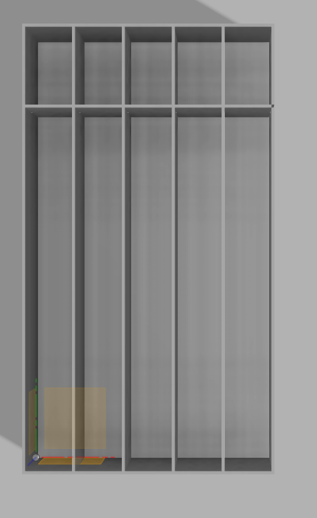

# Background

The storage area for the materials used at the laser is a disaster. With little organization we end up with an ever increasing amount of material that is being stored on-site. It's HeatSync Labs, not HeatSync storage. This proposal is to build a series of storage shelves with a system to allow for on-going organization and maintenance.

*PXL_20201228_175920778.jpg*

# Overview

The storage is divided up into three spaces. The idea is that these spaces act together to maintain storage and organization over the long term by creating a system where materials are automatically cycled through.

This is sized to fit into the current space for the storage and "Bike Repair Station". This is a single horizontal cabinet with some tools in one drawer. It receives no use but the tools can be stored upstairs.

## Space 1: Scrap & Equipment

This section has 5 bays. 1 of the bays is reserved for equipment (primarily the honeycomb screens and cleaning materials). The other 4 bays are for scrap. The bays will be painted with the following color coding:

- Green: Newest scrap
- Yellow: Scrap 1 cycle old
- Orange: Scrap that is 2 cycles old
- Red: Scrap that will be trash on the next cycle.

*Screen_Shot_2021-02-12_at_7.18.49_PM.png*

## Space 2: Limited member storage

This section has (planned) 8 bays that can be rented by members to hold their materials. The idea is that this is not a profit center, but requires a certain amount of commitment to maintain. Suggestion is that this is a random draw if demand exceeds number of bays, with a monthly cost of \$1/month for using the bay. Draw could happen quarterly or bi-annually at a convenient HYH.

*laser_storage_bay2.png*

## Space 3: General storage

This is a four bay system setup identical to space 1, but without the equipment space. The four bays are:

- Green: Most recent storage
- Yellow: Storage that has been there one cycle
- Orange: Storage that has been there two cycles
- Red: Storage that has been there three cycles. The next destination for this bay is the Green bay of scrap.

# Process

On a periodic basis (not more frequent than weekly) all materials will be cycled through the bays in the following manner:

- Anything in the red bay of scrap will be thrown out
- All bays (except red of storage) will be moved up one bay
- Red of storage gets cycled to green of scrap

# Discussion

This system allows for members to store material on-site in designated bays for up to a month (1 week x 4) if they don't have a member storage bin. From there, it has an additional month of life as scrap available for general use before it would be thrown out.

# Design

This is a preliminary design for the storage.

## Considerations

- The bottom section should be at least 155cm tall to allow for the common sheets to be stacked without requiring that they be angled, to allow for maximum storage
- The overall height should fit within the space currently between the floor and the top overhang (roughly 192 cm)
- Depth should be enough to allow for materials to not fall out. This specific depth was chosen to allow for two side panels out of a single 4x8 sheet of plywood

## Material

- Current thought is 1/2" plywood for the entire portion, except for the back panel which can be 1/4" since it is not structural, but necessary for square

---
*Categories: [Proposals](Category-Proposals)*
