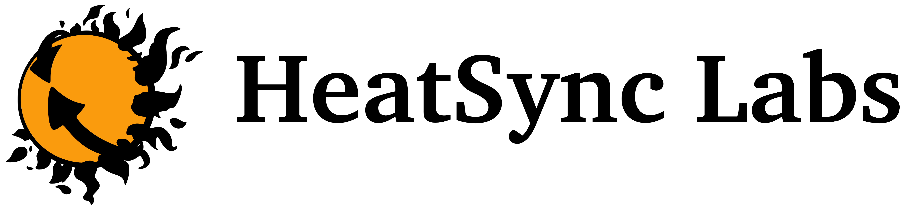
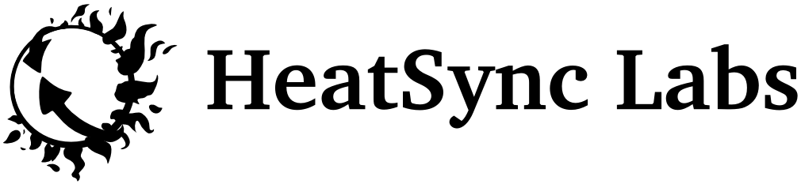

Thank you for your interest!

See a press-ready description of HeatSync here: <http://www.heatsynclabs.org/about/>

**Please remember:** the proper spelling/capitalization is **HeatSync Labs** or simply **HeatSync**, and our preferred pronouns are *hackerspace, makerspace, workshop, or community*. It may be tempting or convenient to call us an incubator, coworking space, or hangout, and those things might happen at HeatSync, but that isn't our purpose or focus and so using those words detracts from the physical creation and invention that is our core purpose.

## Logo Pack & Brand Standards

Download the branding guidelines here for proper use of our logo, etc: [Heatsync_labs_logo_pack.zip](files/Heatsync_labs_logo_pack.zip)

**For just our brand standards, see: [Heatsync_labs_brand_standards.pdf](files/Heatsync_labs_brand_standards.pdf)**

## Flier / Poster

Promote HeatSync with this snazzy flier: [hsl_flier_1.pdf](files/Hsl_flier_1.pdf)

## Selected bitmaps (see logo pack for vectors)

   
