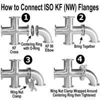
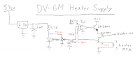
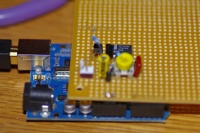
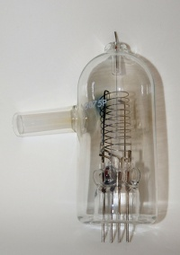

*Just brainstorming -- in the sketch, purple is status as of 3/2/2011, blue and green are welding needs, and orange is post-welding.*

.svg.png)

*X-ray detector might come after everything else ;)*

## Project Description

### Lets build an SEM from scratch!

The field of SEM means big bucks. The cheapest SEM just came on the market a few years ago and costs \$70,000 US. The accelerating voltage is limited to 5kV and the sample chamber is micro-miniature. On the other end of things a full sized SEM is going to run you millions of dollars. Let's laugh a lot and make our own unit with a generous sample chamber and whatever accelerating voltage that we want (20kV would be more than enough). -Jasper

Here's the recorded stream from Brandon's and Jasper's presentations (sorry for the crappy quality!):

<http://www.ustream.tv/recorded/12763200>

## Vacuum Information

A tungsten filament will burn out at 10^-2 Torr or higher. Therefore, it is absolutely neccesary that we get our vacuum system working to a sufficient degree that we reach the mreasurement limit of our DV-6M thermocouple gauge (10^-3 Torr).

### Flanges

\
For the best vacuum, we should use either conflats or QF/KF fittings. QF/KF is good to 10^-8 Torr which is more than enough. Conflat would be nice, but is more expensive and more hassle as the seals are only good for a single mate. QF uses a viton O-ring (Isopropanol, but not methanol or acetone, can be used to wipe Viton o-rings clean) while conflat uses a single-use-only copper gasket with biting metal knife edges on either side to form a gas tight metal-metal seal.

### Hose To Chamber Fitting

We should weld on a [QF40-150-ALF](http://www.ancorp.com/product.aspx?id=3606) (KF40 half nipple, 6061-T6 Aluminum, \$15.50) onto the chamber and use a [KF40-HA](http://www.duniway.com/images/pdf/pg/p-06-to-08-hard-kf-fit-quick-flange.pdf) (KF40 Flange To Hose (1 1/2” or 1 5/8” ID) Adaptor, Aluminum, \$17) to link up the hose. For hose we should use 1.5" gum rubber which is ~\$17 per foot new. Surplus would be a good thing here as we need about 3 feet.

### DV-6M Gauge

\
The DV-6M is a thermocouple vacuum gauge which relies on the thermal conductivity of the air to measure a vacuum between 10 Torr and 10^-3 Torr. At atmospheric pressure the tiny hair sized thermocouple wires dissapate all of their heat into the air and the thermocouple reads a lot ambient measurement (0.6mV). At 10^-3 Torr the conductivity of the air drops to a point where all of the heat is retained in the heating element and the gauge reaches its full-scale reading. To read below this the B-A Gauge described below.

  The DV-6M contains the thermocouples in series with the heating element so a DC heating current of 21mA (0.380V across the 19.2Ω Heater) needs to be interrupted for ~5ms in order to take the reading of the thermocouple. A prototype interruptible supply was made which appears to work but will need further integration into the thermocouple amplification circuitry.

### B-A Gauge

\
The [Bayard-Alpert hot cathode ionization gauge we have](http://www.flickr.com/photos/nebarnix/5470607516/) has a 3/4" glass interface. Reccomend we weld a [QF25-100-ALF](http://www.ancorp.com/product.aspx?id=3605) (KF25 half nipple, 6061-T6 Aluminum, \$14) to the chamber and use a [KF25-CP75](http://www.duniway.com/images/pdf/pg/p-06-to-08-hard-kf-fit-quick-flange.pdf) (KF25 Flange To 3/4” Compression Port, \$68) as a glass to metal interface.

## Acquired

- Vacuum Chamber, \$500
  - 23"x11"
  - Aluminum
- CF-218 right angle manual valve
- Vacuum Pump, Dual-Stage Dual-Vane Rotary, Welch 1402, 10^-4 mTorr, \$300
- Basic Hose for testing, Free
  - Hose Clamps, \$7.50
- Electron Emitters, Donated, used
- Vacuum Gauges
  - DV-6M, Free with Chamber
  - B-A Glass, \$35

## In Progress

- - Driver/meter for the DV-6M thermocouple gauge, (Jasper)
  - Boring hole in chamber for the KF-25 to be welded in (Corey)

## Needed

- Belt Drive Vacuum Pump Oil
- Fittings
  - KF-25 half-nipples for playing with feedthroughs
    - These might be lathable
  - KF/CF half nipple for exhausting the chamber.
    - Will require an adapter to connect to the CF valve if not CF-218
- Vacuum hose, clear is ok, reddish is better (6 feet, 1" ID)
- Material for lenses (silicon steel? permeable iron/steel alloy? must be available in round stock)
  - HT power supply (1-20kVDC, 1-5kVDC OK for now)
    - Flyback transformer with variable duty cycle (to vary output voltage) and output capacitor to smooth waveform
    - Digital interface for varying the duty cycle
- Webcam + White LED to mount inside of chamber
- Driver/meter for the Bayard-Alpert hot cathode ionization gauge

## Completed

### Feb 20th

We created a vacuum with the Pump, Chamber, and Hose setup that we purchased the other day. The DV-6M thermocouple gauge is strange, but we managed to figure out how to get a useful reading out of it. It still has some weird parts that we need to figure out in order to correlate against a known vacuum level, but for now we have a relative baseline established of [198.207.0.5](Special-Contributions-198.207.0.5)1 Torr. Looks like we have a bit of leakage from the hose connections at the moment.

### Feb 21st

Upon discovery of the leak using the water pour and vacuum gauge method, and an attempt was made to reseal the threads. Unfortunately a crack was discovered which caused the main valve (Swagelok Whitey Ball Valve SS 45S8) to shear off leaving half of the adapter fitting inside of the chamber and the other half in the valve.

### Feb 22nd

Bayard-Alpert hot cathode ionization gauge came in the mail today. Looks pretty sexy. We will need two more power supplies (+200VDC, -50VDC) a pico-amp meter, and a way to attach the glass tube to a metal flange. Looks like this will probably require some TIG welding, hopefully the MCC welding shop can help us out here.

### Feb 25th

Paul has contacted a TIG welder at MCC who has previous experience with vacuum chambers and who has offered to help us for free (and possibly beer). We need him to weld on some aluminum KF-25 / CF half-nipples for exhausting the chamber as well as for feedthrough prototypes.

## Next Steps

- Fix the vacuum hose fitting which broke off and attempt to get a better vacuum
- Build permanent circuit and enclosure for driving the gauge heater to 20mA.
- Provide a digital readout of the thermocouple voltage as well as output the data onto a digital interface line for future incorporation.
- Weld on the QF/KF flanges and mount the B-A gauge

## Cost Breakdown

| Description                                | Cost                    |
|--------------------------------------------|-------------------------|
| Welch 1402 Rotary Vane Pump                | \$300                   |
| 1/2 Gallon of mineral oil                  | \$10                    |
| 23"x11" Vacuum Chamber, Al, W/ DV-6m Gauge | \$500                   |
| Bayard-Alpert Glass Gauge                  | \$35                    |
|                                            | Total Cost So Far \$880 |
