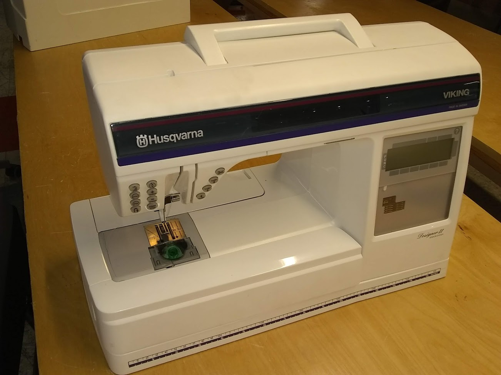
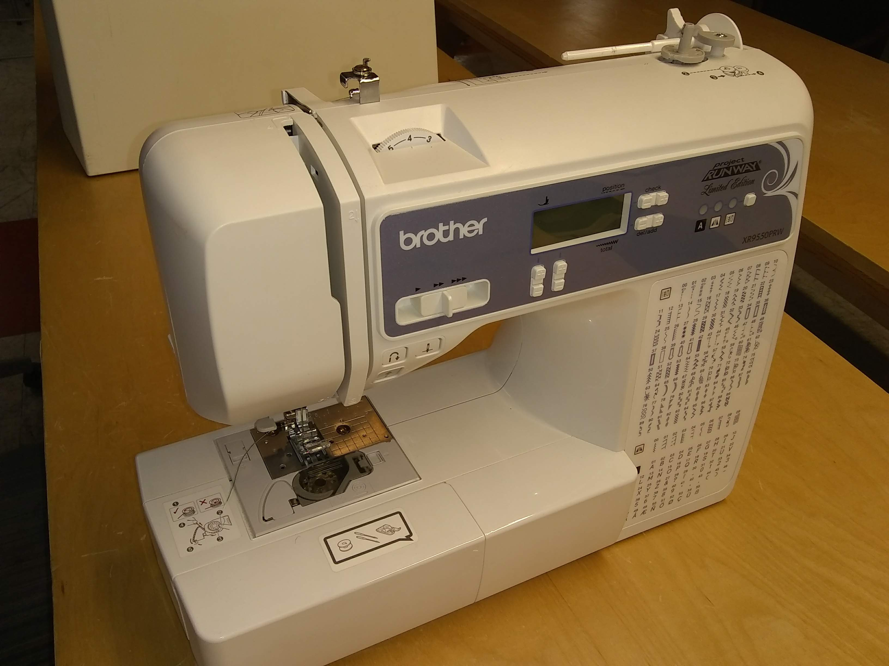
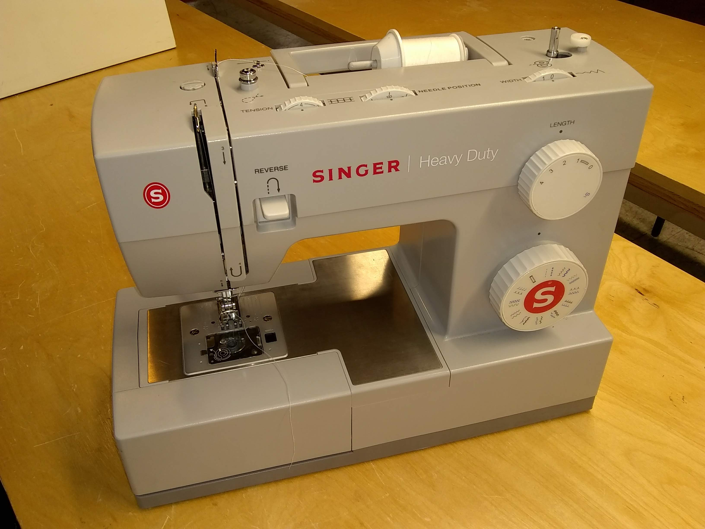

- **Station Champions:** Linda Krecker, and Michelle Mueller
- **Communication:** [Google Discussion Group](https://groups.google.com/g/heatsynclabs/)
- **Certification:** Checkouts for the Consew Industrial machine, Husqvarna Embroidery, Baby Lock Serger
- **Events:** Sewing Night on the 2nd Tuesday each month from 7pm - 10pm

***Generally**...*

- Ask for help
- Machines are delicate, act accordingly
- Clean up after yourself
- Stow machines after use

***If you already know how to sew...***

- Just use the basic sewing machines.

***If you need to use any of these you will need to get checked out during Sewing Night first.***

- Consew Industrial machine
- Husqvarna Embroidery
- Baby Lock Serger

## Embroidery Machine

### Husqvarna (Embroidery)

*Husqvarna_Designer_2.jpg*

A sophisticated sewing machine better suited for ***Intermediate*** or **Advanced** users.

Best use for it's ***Embroidery*** capabilities.

[Husqvarna_Viking_Designer_II_Users_Guide.pdf](files/Husqvarna_Viking_Designer_II_Users_Guide.pdf)

***Husqvarna Viking Designer II User's Guide**, *Manual**

[Husqvarna_Viking_Notes.txt](files/Husqvarna_Viking_Notes.txt)

*Husqvarna embroidery notes*

Video: [**Husqvarna Viking Designer II User's Guide**, *YouTube*, Nov 20, 2019](https://www.youtube.com/watch?v=sGJI4lVcFag)

Need: (Threading Instructions) (common mistakes) ("p" & "q")

Need: (Embroidery Manuals and links)

Need: (D-card upload procedure on Laser Windows XP machine)

Need: (Inkscape and Ink/Stitch tutorial and video link)

Bobbin Winding Instructions (2 methods)

Bobbin: Husqvarna

Embroidery Hoops Sizes

- 100 x 100
- 150 x 240

## Sewing Machine

### Brother (Digital)

*Brother_Project_Runway.jpg*

 **Brother XR9550 Digital Sewing Machine *"Project Runway Limited Edition"*** 

Full-feature *digital* machine. Easy to use.

Good for ***Beginner**'' and***Intermediate**'' users.

- 60 built-in stitch patterns
- foot-pedal or push-button control
- automatic speed control
- automatic needle threader
- automatic back-stitch button
- automatic button-hole feature

**Bobbin**: Brother SA156 (same as class 15J)

[Brother_XR9550_Sewing_Machine_Operation_Manual.pdf‎](files/Brother_XR9550_Sewing_Machine_Operation_Manual.pdf‎)

***Brother XR9550 Sewing Machine Operation Manual**, *Manual**

[Brother_XR9550_Sewing_Machine_Quick_Reference_Guide.pdf‎](files/Brother_XR9550_Sewing_Machine_Quick_Reference_Guide.pdf‎)

***Brother XR9550 Sewing Machine Quick Reference Guide**, *Manual**

------------------------------------------------------------------------

### Singer (Heavy Duty)

*Singer_Heavy_Duty.jpg*

**Singer 4423 Heavy Duty Sewing Machine**

Basic feature *manual* machine.

Good for **'Beginner**' and ***Intermediate*** users.

- Heavy Duty (good for denim, etc)
- 22 built-in stitch patterns
- button hole pattern

[Singer_4423_Heavy_Duty_Sewing_Machine_Instruction_Manual.pdf‎](files/Singer_4423_Heavy_Duty_Sewing_Machine_Instruction_Manual.pdf‎)

***Singer 4423 Heavy Duty Sewing Machine Instruction Manual**, *Manual**

Bobbin: Class 15

specs, image, model, manual

------------------------------------------------------------------------

### Bernina (Industrial)

Training Required!

specs, image, model, manual

------------------------------------------------------------------------

## Serger Machine

### Baby Lock (Serger)

specs, image, model, manual
