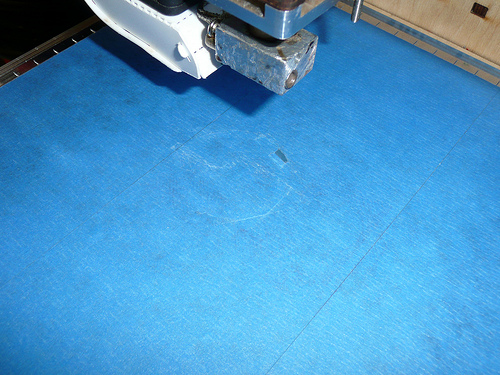

**The Ultimaker is Currently Running at 100%**

The Ultimaker is our wonderful fancy Dutch 3D printer. Much like their shoes, the Dutch chose to build the 3D printer using a wood frame. Using the Ultimaker isn't entirely difficult, it just takes a quick walkthrough to get it running.

We are currently using Cura for our slicing.

## Getting your STL

If you're downloading your model from [Thingiverse](http://thingiverse.com), it'll probably have an STL file available. If they don't, match their file types with the sections below, or [ask the internet](http://google.com).

The Ultimaker slicing programming (Cura) will only import STL files currently. Getting STLs out of your program of choice depends on your program of choice. If yours is not documented [ask the internet](http://google.com) and then document it here.

Place your downloaded STL on the HSL [3D Printing Station Computer](3D-Printing-Station-Computer) in the Downloads/ folder, in a directory with Your Name. Files floating around freely in Downloads will be mercilessly deleted.

### OpensCAD (\*.scad) (0\$)

OpenSCAD natively exports STL files after building. Construct your model, and then go to the Design menu and hit "Compile and Render (CGAL)". After that, hit the "Export as STL" option in that same menu.

## Slicing

Slicing is what turns the STL model (consisting of a list of the triangles in the model), into a list of commands that the printer understands. This list is called [GCode](http://linuxcnc.org/docs/html/gcode/overview.html).

- Open the model in Cura by double clicking on it
- Here you can rotate, move, and resize the model,
  - Your model will print as it appears in the build preview. Make sure that it is centered and on the build platform, laying flat, using the move, rotate and resize tools.
  - If your print has crazy overhangs or intricate details, it may **not** print well on our machine. :(
- Select 'Switch to full settings' on the tools menu. This allows you to select the print profile for the filament you are using
- Select 'Open Profile' on the 'File' menu and navigate to the 'Downloads' folder. Choose the \*.ini file for the color filament you are using e.g. 'silver_pla_cura.ini'
- Each filament has different properties and needs different settings, mainly diameter, flow %, temperature, and retraction distance.
  - Leave those settings as they are, but feel free to adjust fill density, support, etc. as needed
- Cura has many helpful view modes, available in the upper right corner of the screen
  - 'Layers' allows you to preview how it will print, layer by layer, showing shells, fill, support, etc. in different colors
  - 'Overhang' highlights overhanging areas in red, suggesting the need for support
  - 'Normal' allows for resizing and rotating the object

<!-- -->

- Click the "Save Toolpath" button (floppy disk icon) to save the gcode to the SD card.

### Adjusting print profile settings

If those defaults don't make sense to you for some reason (You're printing a structural piece for example and need a stronger infill) you can adjust the settings, but realize that will probably affect print time and final weight and will make Baby Jesus cry.

**DO NOT OVERWRITE DEFAULT PROFILES!**

Please name your profile in the following format: TMP \$YOURNAME \$REMINDER or \$YOURNAME \$REMINDER, where reminder is something like 10% or hollow infill, or something like that so that you don't forget. Temporary profiles may be deleted when I am cleaning the machine up, UM profiles will stay.

## Getting GCode on the Printer

- Pull the SD card out of the left side of the UltiController and put it in the computer
- In Cura, Click the "Save Toolpath" button (floppy disk icon) to save the gcode to the SD card.
- Put the SD card back in to the printer.

Our UltiMaker has an [UltiController](https://shop.ultimaker.com/en/parts-and-upgrades/ulticontroller-ultipanel.html) installed on it, a marvel of Dutch engineering which allows you to, using the amazing power of LCD displays and Secure Digital cards control the printer without the use of a PC computer. While this may sound limiting, there are huge benefits to printing this way:

- Because the USB serial link is slower, you cannot get the printer to do crazy things like print at 700% speed
- Prints can pause or hang due to high load on the computer causing an interrupt in USB serial communications. This usually ends up with nasty globs of plastic on the model or, commonly, print failures.

Seriously follow this, don't use USB serial. It's just as easy and less painful.

## Print

Make sure the build platform is clean and has tape that doesn't have large holes in it. If we're out of 3" blue painters tape, please add it to the shopping list and bother [User:rrix](User-rrix). Note that the tape does not need to be perfect, just flat and lacking large holes.

 This is okay!

The UltiController has a scroll knob on the left end, it's also a button.

- Push the button to get in to the menu
- Navigate to "SD Card Menu" and push the button
- Navigate to your print and push the button

The machine will zero itself and begin heating the machine for the print. When it has reached temperature it will begin printing.

## Oh noes!

When something goes wrong on your print, don't panic, even if the heated nozzle is crashing in to the acrylic build platform.

### Stop the Print

If it's not a "HOLY SHIT THE MACHINE IS BROKEN" issue, you can just stop the print.

- Press the button to enter the device menu
- Scroll the button all the way down to "STOP PRINT" and press the knob

Your print will stop within 30 seconds and you can [Home The Nozzle](#home-the-nozzle) and peel your failed print off.

### KILL DASH NINE

If something is going haywire, shut the machine off using the switch on the right side and pull the steppers out of the way by hand. If the machine is not in order to print after this, please make a note on it and inform [User:rrix](User-rrix) ASAP.

## Cleaning Up

When you're done, clean up the build area, deposit any trash PLA in the PLA trashcan (For when we eventually build a [Filibot](Filibot)) and make sure the machine is turned off when you're done.

### Logging your Work (WIP)

Much like the laser cutter, we like to track usage of the Ultimaker for assessing wear and tear and statistics on prints. Please fill out the log when you are finished by clicking the "3D Printer Log" icon on the desktop.

This includes tracking failed prints, just record how far the machine got before it failed, and the reason why.

# But Wait!

There's more! Take a look at the [Ultimaker](Ultimaker) page for more information about the printer and how you can get more involved in 3D printing at HeatSync Labs.
